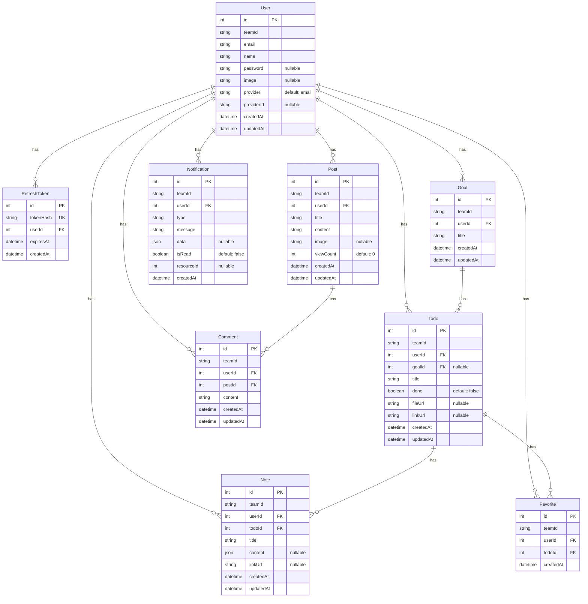

# ERD (Entity Relationship Diagram)

---

## 모델 속성 정리

### User (사용자)

| 속성 | 타입 | 설명 |
| --- | --- | --- |
| id | Int (PK) | 사용자 고유 식별자 |
| teamId | String | 팀 식별자 |
| email | String | 이메일 |
| name | String | 이름 |
| password | String? | 비밀번호 (OAuth 사용자는 null) |
| image | String? | 프로필 이미지 URL |
| provider | String | 인증 제공자 (`email` / `google` / `kakao`) |
| providerId | String? | OAuth 제공자 ID |
| createdAt | DateTime | 생성일시 |
| updatedAt | DateTime | 수정일시 |

---

### RefreshToken (리프레시 토큰)

| 속성 | 타입 | 설명 |
| --- | --- | --- |
| id | Int (PK) | 토큰 고유 식별자 |
| tokenHash | String (UK) | 토큰 해시값 |
| userId | Int (FK) | 토큰 소유 사용자 ID |
| expiresAt | DateTime | 토큰 만료일시 |
| createdAt | DateTime | 토큰 발급일시 |

---

### Goal (목표)

| 속성 | 타입 | 설명 |
| --- | --- | --- |
| id | Int (PK) | 목표 고유 식별자 |
| teamId | String | 팀 식별자 |
| userId | Int (FK) | 목표 소유 사용자 ID |
| title | String | 목표 제목 |
| createdAt | DateTime | 생성일시 |
| updatedAt | DateTime | 수정일시 |

---

### Todo (할 일)

| 속성 | 타입 | 설명 |
| --- | --- | --- |
| id | Int (PK) | 할 일 고유 식별자 |
| teamId | String | 팀 식별자 |
| userId | Int (FK) | 할 일 소유 사용자 ID |
| goalId | Int? (FK) | 연결된 목표 ID |
| title | String | 할 일 제목 |
| done | Boolean | 완료 여부 (기본값: false) |
| fileUrl | String? | 첨부 파일 URL |
| linkUrl | String? | 링크 URL |
| createdAt | DateTime | 생성일시 |
| updatedAt | DateTime | 수정일시 |

---

### Note (노트)

| 속성 | 타입 | 설명 |
| --- | --- | --- |
| id | Int (PK) | 노트 고유 식별자 |
| teamId | String | 팀 식별자 |
| userId | Int (FK) | 노트 소유 사용자 ID |
| todoId | Int (FK) | 연결된 할 일 ID |
| title | String | 노트 제목 |
| content | Json? | 노트 내용 |
| linkUrl | String? | 링크 URL |
| createdAt | DateTime | 생성일시 |
| updatedAt | DateTime | 수정일시 |

---

### Favorite (찜한 할 일)

| 속성 | 타입 | 설명 |
| --- | --- | --- |
| id | Int (PK) | 찜 고유 식별자 |
| teamId | String | 팀 식별자 |
| userId | Int (FK) | 찜한 사용자 ID |
| todoId | Int (FK) | 찜한 할 일 ID |
| createdAt | DateTime | 생성일시 |

---

### Post (게시글)

| 속성 | 타입 | 설명 |
| --- | --- | --- |
| id | Int (PK) | 게시글 고유 식별자 |
| teamId | String | 팀 식별자 |
| userId | Int (FK) | 작성자 ID |
| title | String | 게시글 제목 |
| content | String | 게시글 내용 |
| image | String? | 이미지 URL |
| viewCount | Int | 조회수 (기본값: 0) |
| createdAt | DateTime | 생성일시 |
| updatedAt | DateTime | 수정일시 |

---

### Comment (댓글)

| 속성 | 타입 | 설명 |
| --- | --- | --- |
| id | Int (PK) | 댓글 고유 식별자 |
| teamId | String | 팀 식별자 |
| userId | Int (FK) | 작성자 ID |
| postId | Int (FK) | 게시글 ID |
| content | String | 댓글 내용 |
| createdAt | DateTime | 생성일시 |
| updatedAt | DateTime | 수정일시 |

---

### Notification (알림)

| 속성 | 타입 | 설명 |
| --- | --- | --- |
| id | Int (PK) | 알림 고유 식별자 |
| teamId | String | 팀 식별자 |
| userId | Int (FK) | 알림 대상 사용자 ID |
| type | String | 알림 유형 (`todo` / `goal` / `post` / `comment`) |
| message | String | 알림 메시지 |
| data | Json? | 추가 데이터 |
| isRead | Boolean | 읽음 여부 (기본값: false) |
| resourceId | Int? | 관련 리소스 ID |
| createdAt | DateTime | 생성일시 |
